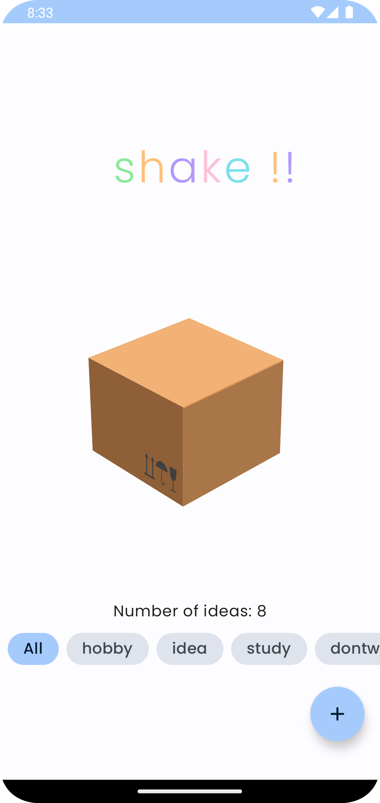
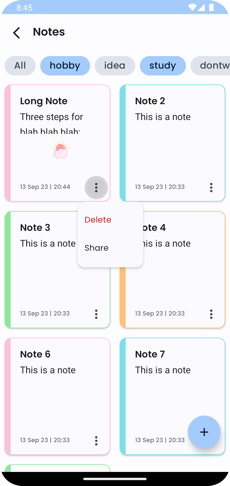
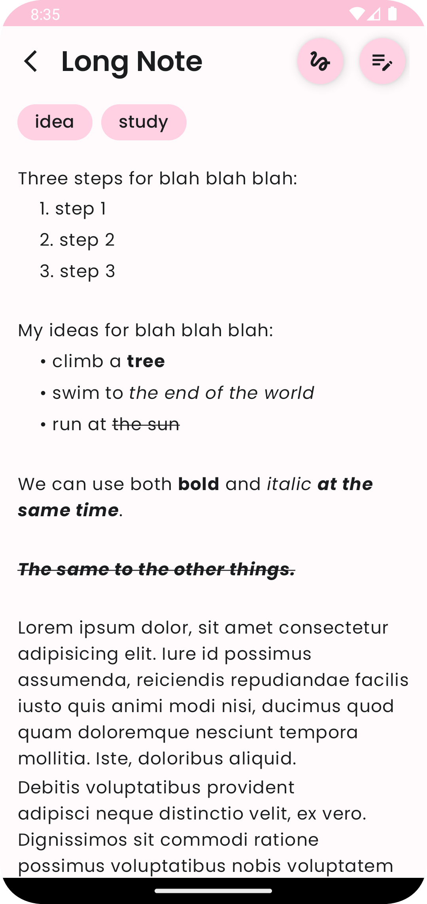
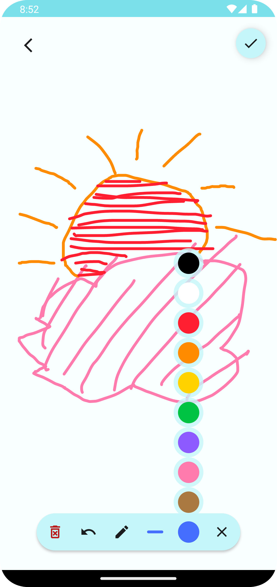
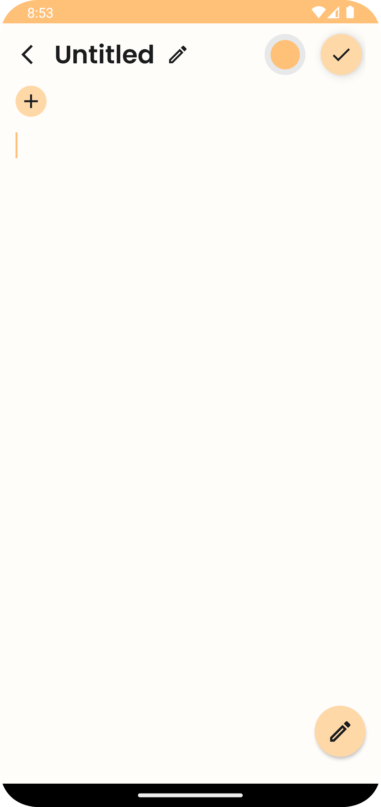
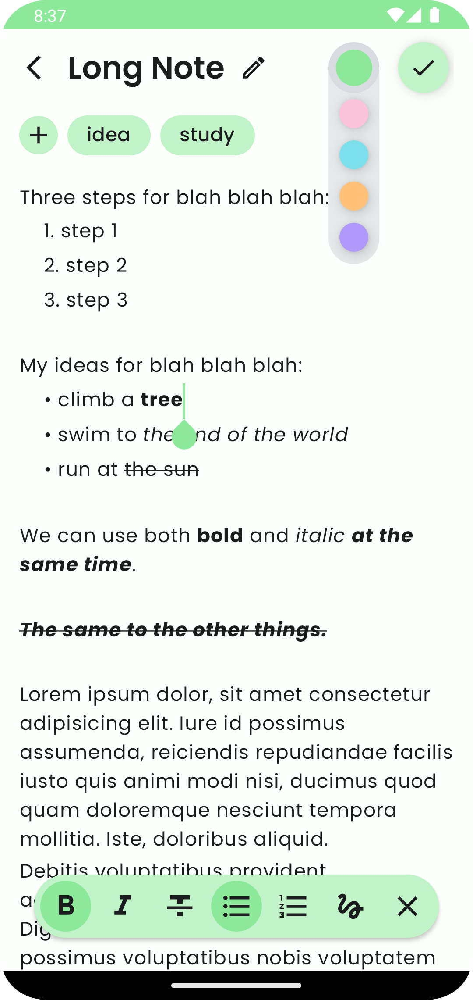
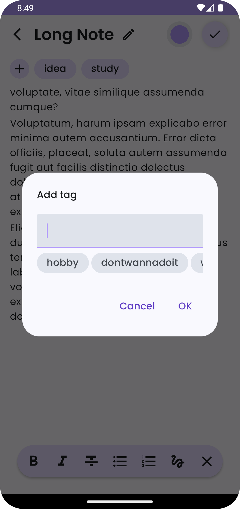

# IdeaWhirl

IdeaWhirl is an Android note-taking app for collecting ideas and getting them back at random. Write notes with rich text, tag them, sketch on them, and when you can't decide what to do next, **shake your phone**: the box on the home screen wobbles, opens, and hands you a random idea.

Built with Kotlin and Jetpack Compose.

<p align="center">
  
  
  
  
</p>

## Features

### Shake for a random idea
The home screen shows an animated box (Lottie) and how many ideas you have. Shake the device and the box shakes along, opens, and shows a random note from the current selection. Tap the card to open the note. Filter by tags first to draw only from certain kinds of ideas. Tap the box to go to the full note list.

### Note list
All notes appear as cards in a two-column grid, newest first. Each card shows the title, a Markdown preview of the content, a thumbnail of the drawing, and when it was last edited. Filter by one or more tags, and use the card menu to **delete** a note or **share** its title and content through the Android share sheet.

### Rich text notes
Notes are written in a rich text editor with **bold**, *italic*, ~~strikethrough~~, bulleted lists and numbered lists. Content is stored as Markdown. Each note has:
- an editable title
- tags: add new ones or pick from tags you've already used
- a color theme picked from five pastel palettes (pink, blue, green, orange, purple) that tints the whole screen, with matching dark-mode colors

<p align="center">
  
  
  
</p>

### Drawing board
Every note has a sketch. The drawing board has a pen and an eraser with five stroke widths, ten colors, undo and clear. When you open a note, its drawing is replayed stroke by stroke.

<p align="center">
  
</p>

## Tech stack

| Area | Library |
| --- | --- |
| UI | Jetpack Compose, Material 3, Navigation Compose |
| Architecture | MVVM: `ViewModel` + `StateFlow` per screen, a single `NoteRepo` |
| Storage | Room (notes and tags), kotlinx.serialization JSON files (drawings) |
| Rich text | [compose-rich-editor](https://github.com/MohamedRejeb/Compose-Rich-Editor) for editing, [compose-markdown](https://github.com/jeziellago/compose-markdown) for previews |
| Animation | [Lottie Compose](https://github.com/airbnb/lottie-android) |
| Sensors | `SensorManager` accelerometer for shake detection |

## Project structure

```
app/src/main/java/com/example/ideawhirl/
├── MainActivity.kt          # sets up the database, repo and nav graph
├── ShakeDetector.kt         # accelerometer listener that detects a shake
├── model/Note.kt            # the Note domain model
├── data/
│   ├── data_source/         # Room database, NoteEntity/TagEntity and DAOs
│   └── repo/NoteRepo.kt     # notes, tags and drawing files in one place
└── ui/
    ├── home/                # shake box screen + random note dialog
    ├── notelist/            # grid of notes with tag filter
    ├── note/                # rich text note view/editor
    ├── notedraw/            # drawing screen for a note
    ├── components/          # tag pills, tag filter, color picker, drawing_board/
    ├── navigation/          # routes and NavHost
    └── theme/               # colors, note palettes, Poppins typography
```

Notes and tags are stored in two Room tables (`NoteEntity`, `TagEntity`, with tags cascading on note delete). Each note's drawing is saved separately as `drawing_<uid>.data` in the app's internal storage.

## Getting started

### Requirements
- Android Studio (Giraffe or newer)
- JDK 18 (the build uses a Java 18 toolchain)
- Android SDK 34; the app runs on Android 7.0 (API 24) and up

### Build and run
Open the project in Android Studio and run the `app` configuration, or from the command line:

```bash
./gradlew installDebug
```

Shake detection uses the accelerometer. On an emulator, use **Extended controls → Virtual sensors** to simulate movement.

### Tests

```bash
./gradlew test                  # unit tests
./gradlew connectedAndroidTest  # Room and repository tests (needs a device or emulator)
```

## Current limitations

- The Room database is created **in memory**, so notes don't persist after the app is closed. On launch the repo seeds a few sample notes.
- There's no settings screen yet.
